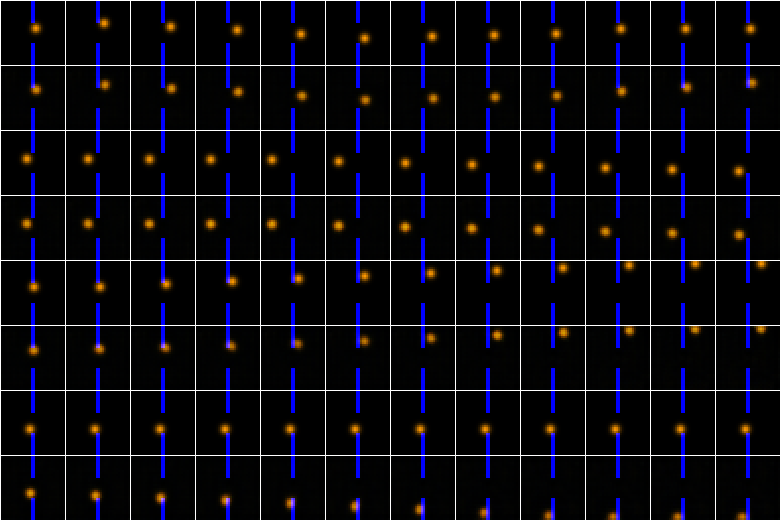
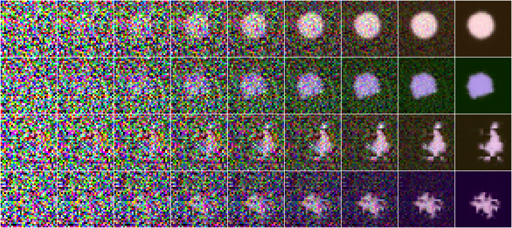

# AI Study: An Advanced Knowledge Base for Building Frontier AI

A curated, opinionated guide to **language models, world models and diffusion models**: how they are built, trained, stabilised and served in 2026. It comes with **from-scratch PyTorch reference implementations** (architecture → training → inference) that run on a laptop CPU and scale with flags, plus chapters on **AI philosophy and ethics** and **neuroscience and AI** (fruit-fly connectome to NeuroAI).

> Research snapshot: **November 2026.** Every chapter starts with a *short conclusion*, then gives tables of primary sources (papers, code, courses) with one-line takeaways. Claims are graded: where a source is a company announcement or secondary coverage, it is marked as such. Verify fast-moving numbers (model sizes, benchmark scores) against the linked primary source before citing them.

---

## Map of the knowledge base

| # | Chapter | What you get |
|---|---|---|
| 00 | [Learning path & resources](docs/00-learning-path-and-resources.md) | Courses, books, blogs, reference repos, and a 16-week plan mapped to this repo |
| 01 | [Language models](docs/01-language-models.md) | The 2026 block (RMSNorm, RoPE, GQA/MLA, QK-norm, gated attention, SwiGLU), MoE, sparse/hybrid attention (DeepSeek-V3.2/V4, Qwen3.5, Kimi Linear, Mamba-3), MTP, mHC, scaling laws, diffusion LMs |
| 02 | [World models](docs/02-world-models.md) | Generative (Genie 3/4, Cosmos), latent/JEPA (V-JEPA 2, DINO-WM, LeJEPA, LeWorldModel, AMI Labs), RL (DreamerV3, Dreamer 4, TD-MPC2); planning |
| 03 | [Diffusion & flow models](docs/03-diffusion-models.md) | The unified theory, DiT/MM-DiT, flow matching, latent spaces (VAE, REPA, RAE), pixel-space JiT, few-step (sCM, MeanFlow), guidance, evaluation |
| 04 | [Training techniques](docs/04-training-techniques.md) | Data, µP/CompleteP, AdamW vs **Muon/MuonClip**, WSD schedules, critical batch size, bf16/FP8/NVFP4, FSDP/TP/PP/EP, MFU, experiment methodology |
| 05 | [Gradient control & stability](docs/05-gradient-control-and-stability.md) | Causes of loss spikes and their fixes, clipping/AGC/skip-step, monitoring dashboard, RL stability, debugging playbook |
| 06 | [Post-training & alignment](docs/06-post-training-and-alignment.md) | SFT, DPO, RLHF, **RLVR** (GRPO, DAPO, Dr. GRPO, GSPO, CISPO), scaling RL, test-time compute |
| 07 | [Inference & serving](docs/07-inference-and-serving.md) | KV cache, PagedAttention, prefix caching, disaggregation, speculative decoding, quantisation, sampling |
| 08 | [Evaluation & interpretability](docs/08-evaluation-and-interpretability.md) | Benchmarks (HLE, SWE-bench, METR, ARC-AGI-3), evaluation hygiene, SAEs, circuit tracing |
| 09 | [**AI philosophy & ethics**](docs/09-ai-philosophy-and-ethics.md) | What is intelligence / AGI (5 competing definitions), **Michael Timothy Bennett** (weakness, Stack Theory, conscious machines), incentives (Goodhart → emergent misalignment), ethics guides (Claude's constitution, International AI Safety Report 2026, EU AI Act), idealism vs caution, consciousness |
| 10 | [**Neuroscience & AI**](docs/10-neuroscience-and-ai.md) | **Fruit-fly** connectome (FlyWire), whole-brain models, NeuroMechFly, Eon's embodied fly emulation (with caveats), MICrONS, DishBrain/CL1, theory bridges |
| 11 | [World-class playbook](docs/11-world-class-playbook.md) | Phase-by-phase checklist from problem framing to safe deployment |

## Reference implementations (`aistudy/`)

```
aistudy/
├── common/            optim.py (AdamW groups, Muon, cosine/WSD) · grad.py (clipping, AGC, SpikeGuard,
│                      gradient-noise-scale, z-loss) · ema.py · utils.py (seed, autocast, DDP, atomic ckpt, PNG)
├── llm/               model.py   decoder-only Transformer: RMSNorm, RoPE, GQA, QK-norm, gated attention,
│                                 SwiGLU, DeepSeek-style MoE (sigmoid router, shared expert, aux-loss-free balancing),
│                                 z-loss, soft-cap, KV cache, grad checkpointing, FLOPs/MFU
│                      train.py   warmup+cosine/WSD, grad accumulation + DDP no_sync, bf16/fp16, clipping, AGC,
│                                 spike guard, noise scale, MoE balancing, eval, atomic checkpoints, resume
│                      sampling.py / generate.py   temperature/top-k/top-p/min-p, KV-cached decoding,
│                                 exact speculative decoding with cache rollback
├── world_model/       env.py     TwoRoom pixel environment (vectorised)
│                      model.py   CNN encoder + causal-Transformer predictor + SIGReg (LeJEPA) + probe decoder; CEM planner
│                      train.py / plan.py   multi-step rollout loss, probes, imagination grids; MPC planning vs baselines
└── diffusion/         model.py   DiT with adaLN-Zero, QK-norm, SwiGLU
                       flow.py    flow matching (v- or x-prediction), logit-normal t, Euler/Heun, CFG
                       train.py / sample.py   EMA, label dropout, sample grids; guidance sweep with a classifier metric
tests/test_smoke.py    17 correctness tests (KV-cache equivalence, speculative == greedy, Muon orthogonality,
                       SIGReg collapse detection, x↔v conversion, overfitting checks …) — run in ~5 s
```

### Quick start

```bash
pip install -r requirements.txt
```

```bash
python -m pytest -q
```

```bash
python -m aistudy.llm.train --preset tiny --steps 300
```

```bash
python -m aistudy.llm.generate --ckpt runs/llm/best.pt --prompt "## Training" --temperature 0.8
```

```bash
python -m aistudy.world_model.train
```

```bash
python -m aistudy.world_model.plan --ckpt runs/world_model/last.pt --cross-room --baselines --out runs/world_model/plan.png
```

```bash
python -m aistudy.diffusion.train
```

```bash
python -m aistudy.diffusion.sample --ckpt runs/diffusion/last.pt --eval --cfg-sweep 1 2 3 5
```

With no `--data` flag the LLM trains on this repository's own markdown, so everything is self-contained. More variants:

```bash
python -m aistudy.llm.train --preset tiny --n-experts 8 --moe-top-k 2 --optimizer muon --schedule wsd
```

```bash
torchrun --nproc_per_node=2 -m aistudy.llm.train --grad-accum 2 --spike-guard --noise-scale
```

```bash
python -m aistudy.llm.train --preset base --data data/mycorpus --dtype bf16 --compile --peak-tflops 989
```

### Results from the default commands (CPU only, 4 vCPU, no GPU)

| Model | Run | Result |
|---|---|---|
| LLM (0.9M params, byte-level, trained on these docs) | default, 300 steps, 24 s | initial loss 5.575 = ln(264) as expected → val loss **1.90 nats/byte**; KV-cached decoding matches the full forward pass to 4e-7 and is ~2× faster on CPU |
| LLM MoE (8 experts, top-2) + Muon + WSD (on the repo's Python source) | 150 steps | val loss 1.48; expert max/mean load 3.2 → 2.1 via aux-loss-free biases; gradient noise scale grew from ~360 to ~7,300 tokens as loss fell |
| LLM DDP (2 processes, gloo) + resume | 60 / 160 steps | same code path as multi-GPU; resume continues exactly at the saved step |
| World model (JEPA + SIGReg, 1.0M params) | default, 2,000 steps | linear-probe R² **0.998**; 16-step open-loop error **5.8%** of latent variance |
| World-model planning (CEM + MPC, 20 episodes) | `plan.py --baselines` | **100%** success for random goals (greedy oracle 80%, random 5%) and **100%** for goals in the other room (greedy oracle 65%, random 0%) |
| Diffusion DiT (flow matching, 1.3M params) | default, 4,000 steps | conditional accuracy judged by a classifier that scores 100% on real data: **61% / 70% / 68% / 59%** at CFG 1 / 2 / 3 / 5 (chance = 25%). Circles and squares are good; thin triangles and crosses need more capacity (patch size 2, a wider model, a GPU) |

<p align="center">
  
  
</p>

*Left: odd rows are real frames, even rows are the world model's decoded 12-step "imagination" from the first frame and the actions. The last pair shows compounding error at the wall. Right: flow-matching ODE trajectories from noise (t = 1) to data (t = 0) for the four classes.*

Two real problems were caught during validation and kept as lessons:
1. **The first world-model run collapsed.** SIGReg was stuck at 0.40 and probe R² was ≈ 0, while the prediction loss looked perfect (1e-7). See [docs/02 §4](docs/02-world-models.md#4-what-the-code-in-this-repo-teaches).
2. **The first diffusion evaluator was invalid.** The probe classifier scored only 43% on *real* data. Always validate an evaluator before trusting its numbers.

## How to use this knowledge base

1. Skim each chapter's **Short conclusion** (5 minutes each) to build the map.
2. Follow the [16-week plan](docs/00-learning-path-and-resources.md#5-a-16-week-plan-mapped-to-this-repo). Read a chapter, run the matching script, then do the exercises at the end of the chapter.
3. Read the linked primary papers. The tables tell you *why* each one matters, so you can prioritise.
4. Use [the playbook](docs/11-world-class-playbook.md) when you start your own project.

## Honesty notes

- This is a 2026 snapshot. Some 2026 items, such as Genie 4 details, Eon's fly emulation, and some model sizes, come from secondary coverage and are flagged in the text.
- Michael Timothy Bennett's website was unreachable from the build environment; his work is summarised from arXiv, AAAI and secondary sources with links.
- The code is educational: it is correct and tested, but sized for CPUs. For production use the frameworks listed in chapter 04 §6.
